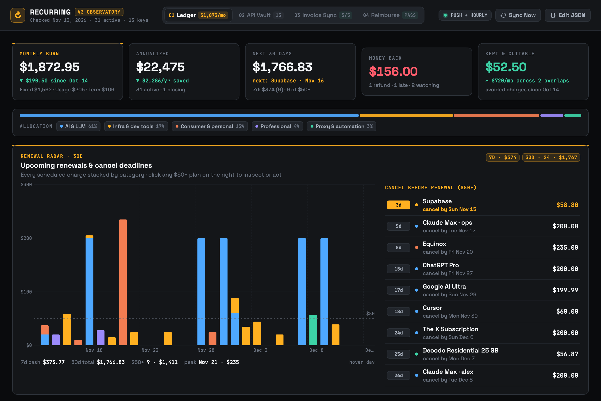
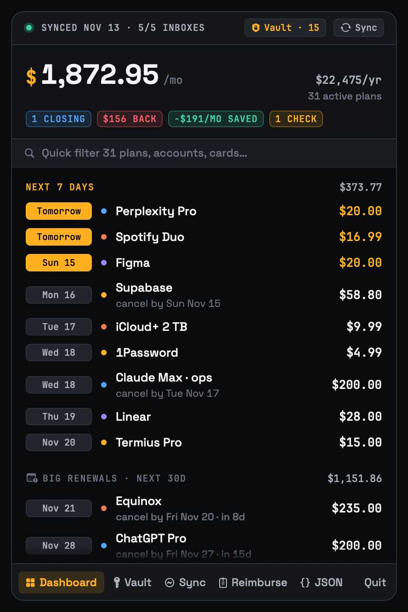
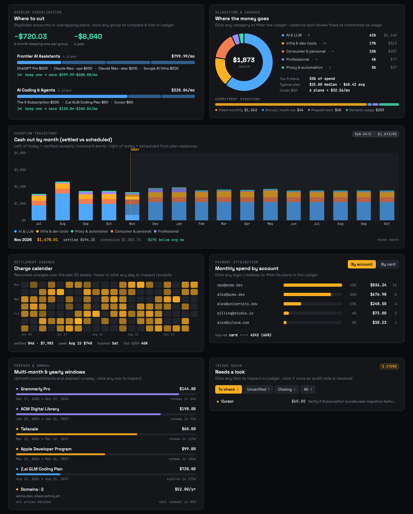
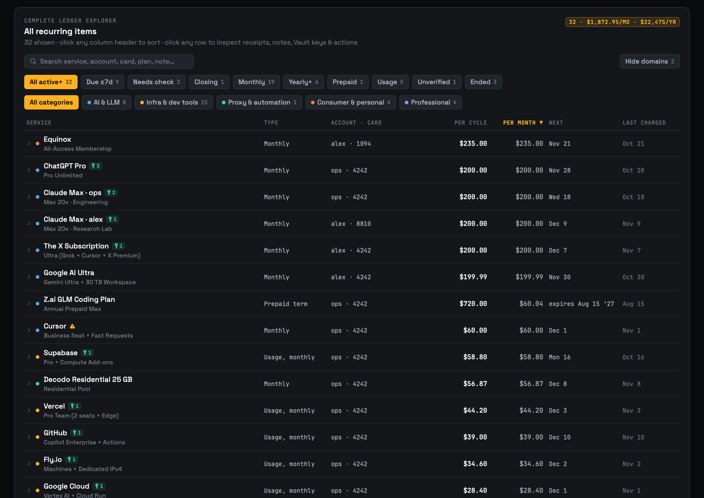
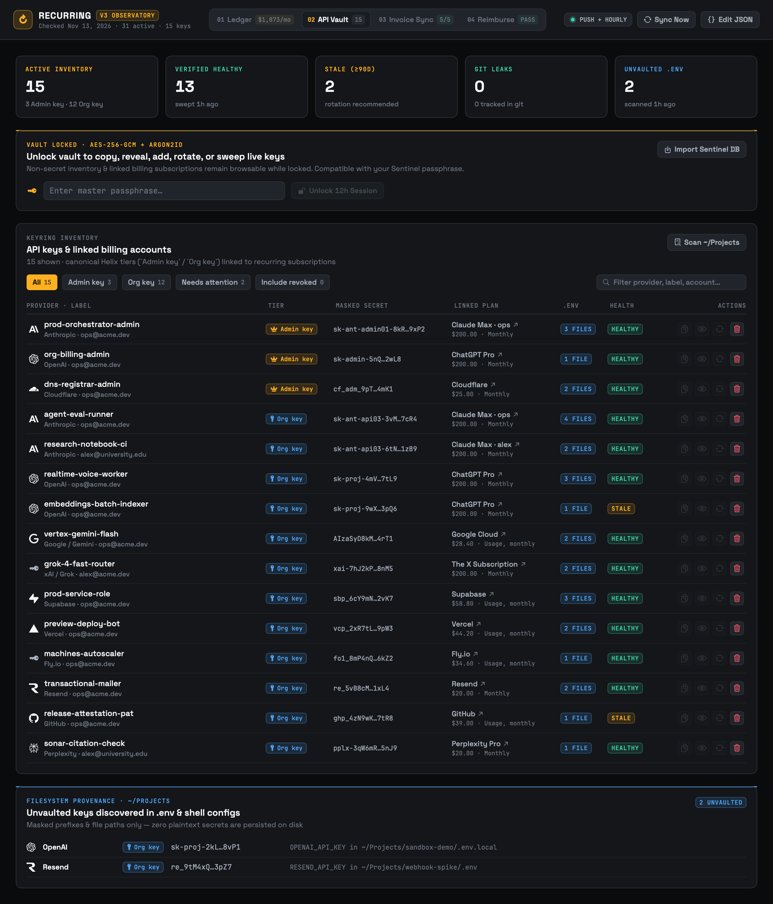
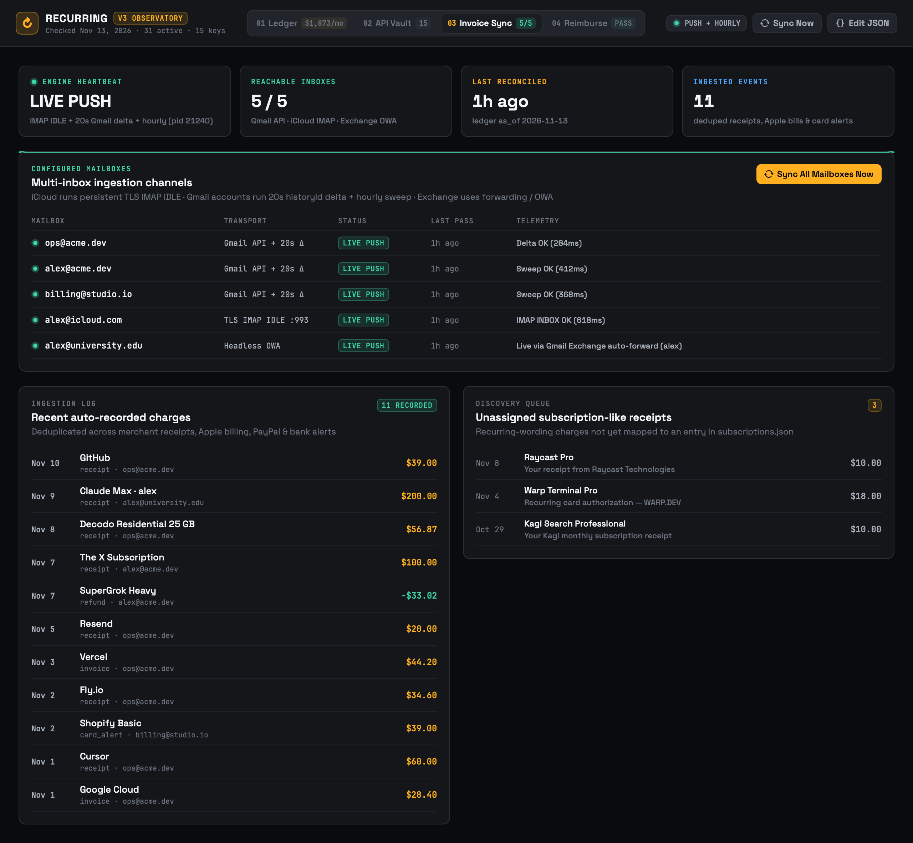
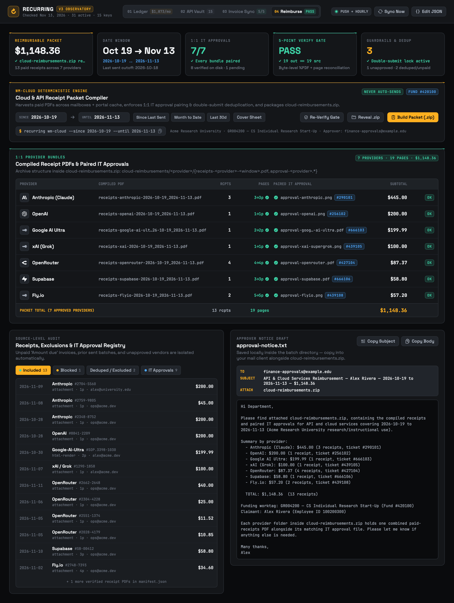
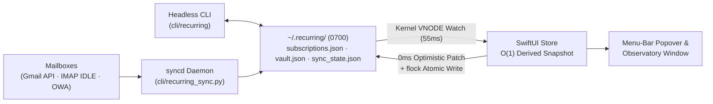

<div align="center">
  
  <h1>Recurring v3</h1>
  <p><strong>macOS Menu-Bar Command Center + Headless CLI for Subscriptions, Real-Time Invoice Sync, Encrypted API Key Management &amp; Deterministic Cloud Receipt Packets</strong></p>
  <p>
    
    
    
    
    
    
  </p>
</div>

---



**Recurring v3** is a native macOS menu-bar application and companion CLI designed on the **Observatory** dark visual language (`#0A0B0D` machined graphite, `#FFB020` signal amber, `#3DD4A7` mint, `#FF5C6C` coral, bundled `Space Grotesk` + `JetBrains Mono`). It unifies recurring spend analytics, live multi-mailbox receipt ingestion, and encrypted developer API key governance in a single local-first workspace—with **zero cloud telemetry** and **byte-for-byte parity** between the SwiftUI app and headless CLI.

---

## Highlights

- **01 · Ledger & Insights** — Track fixed subscriptions, variable usage bills, annual renewals, and upfront prepaid terms (`term_start` → `term_end` amortized across active days). Includes a 30-day renewal radar with cancel-by deadlines, overlap consolidation groups, settled-vs-scheduled monthly cash-flow bars, a 20-week daily charge heatmap, account/card payment attribution, post-cancellation charge watch, and refund claim tracking.
- **02 · Vault · API Keys** — Sentinel-compatible encrypted API key vault (`Argon2id` KDF + `AES-256-GCM` authenticated encryption with AAD binding) supporting two canonical tiers (**`Admin key`** for billing/org management and **`Org key`** for runtime workloads), live provider health sweeps, atomic key rotation, local `.env` provenance & git-leak scanning, and 1-command Sentinel database import.
- **03 · Invoice Sync (`syncd`)** — Persistent background daemon combining `IMAP IDLE` push sockets, 20-second Gmail `historyId` delta checks, Exchange/OWA forwarding support, and an hourly safety sweep. Deduplicates receipts, invoices, refunds, and card alerts across accounts while surfacing unmapped recurring charges in a review queue.
- **04 · Reimburse (`recurring wm-cloud` / `recurring reimburse`)** — Deterministic cloud & API receipt reimbursement compiler across any `[since .. until]` window. Harvests paid receipt PDFs (rejecting unpaid `"Amount due"` invoices), blocks double submissions against prior sent batches, pairs each provider 1:1 with its verified IT approval artifact, runs a 5-point byte/page reconciliation gate (`claimed == embedded PDF pages`), packages `<slug>.zip`, and drafts `approval-notice.txt` locally (never auto-sends).
- **Instant Reactive Architecture** — Optimistic `0ms` in-memory mutations with atomic background persistence, a kernel `DispatchSource` VNODE watcher (`<80ms` CLI-to-UI sync), and precomputed `O(1)` view models so scrolling, sorting, and cross-panel filtering stay smooth at 120 Hz.

---

## Interface Tour

### Menu-Bar Popover & Quick Triage
Click the menu-bar pill from anywhere in macOS to inspect monthly run-rate, upcoming 7-day renewals, high-value 30-day renewals, closing/refund badges, and jump straight into any surface.

<p align="center">
  
</p>

---

### Analytics, Overlap Consolidation & Cash-Flow Attribution
Cross-filter spend by category, commitment structure (fixed recurring vs. metered usage vs. prepaid amortization), monthly settled-vs-scheduled cash flow, 20-week daily charge density, and payment account or card last-4.



---

### Interactive Ledger Explorer & Service Inspector
Search, sort, and filter every active, unverified, closing, or cancelled subscription with inline **Vault key badges** showing which API keys depend on each billed account.



---

### Encrypted API Key Vault (`02 · Vault · API Keys`)
Manage `Admin` and `Org` API keys across Anthropic, OpenAI, Google Vertex/Gemini, xAI, Cloudflare, Supabase, Vercel, Fly.io, Resend, GitHub, and 20+ other providers—complete with live endpoint health checks, `.env` file provenance, git-tracked leak alerts, and 30-second auto-clearing clipboard copy.



---

### Real-Time Multi-Mailbox Invoice Sync (`03 · Invoice Sync`)
Monitor per-mailbox push status (`LIVE PUSH`), inspect matched receipts and negative refund credits, and triage newly discovered recurring merchants before promoting them into your ledger.



---

### Deterministic Cloud Receipt Packet Compiler (`04 · Reimburse`)
Pick any `[SINCE .. UNTIL]` date window (defaulting to the day after your last submitted batch), compile one combined paid-receipts PDF per provider, verify 1:1 IT approval pairing and exact PDF page counts, inspect blocked/deduped exclusions, reveal the `.zip` archive in Finder, and copy the generated approver notice draft.



---

## Architecture & Performance



| Subsystem | Design | Latency / Guarantee |
| :--- | :--- | :--- |
| **UI Mutations** | Optimistic `0ms` state update + background `DispatchQueue.utility` `flock` write | Instant click response, zero main-thread I/O |
| **CLI → UI Sync** | Kernel `DispatchSource.makeFileSystemObjectSource` VNODE watcher (`55ms` debounce) | `<80ms` live UI refresh on external CLI or `syncd` edits |
| **View Derivation** | Precomputed `Store.Derived` & `VaultSnapshot` (`ExplorerState` isolated from charts) | `O(1)` body reads; typing in search never recomputes charts |
| **CLI ↔ App Parity** | Shared normalization & schedule math pinned by `tests/fixtures/parity*.json` | 100% identical numbers across SwiftUI and `recurring` CLI |
| **Headless Snapshots** | Parallel `ImageIO` PNG encoding + CoreGraphics `viewportCard` compositing | Crisp `@2x` Retina renders without opening a window |

---

## Quick Start

### Prerequisites
- **macOS 14.0+** (Sonoma or newer, Apple Silicon or Intel)
- **Xcode 15+** & [`xcodegen`](https://github.com/yonaskolb/XcodeGen) (`brew install xcodegen`)
- **Python 3.11+** (`brew install python`) with `cryptography` (`pip3 install cryptography pytest`) for encrypted vault operations

### Build, Test & Install

```bash
git clone https://github.com/antonio-mastropaolo/recurring.git
cd recurring

# Run the full test suite (Python CLI + vault + sync + Swift model parity tests)
./scripts/test.sh

# Build Release app, install to ~/Applications/Recurring v3.app,
# link ~/.local/bin/recurring, and register LaunchAgents
./install.sh
```

`install.sh` performs a clean atomic swap into `~/Applications/Recurring v3.app`, links `~/.local/bin/recurring`, and registers two user LaunchAgents:
1. `com.amastro.recurring.v3.plist` — launches the menu-bar app at login.
2. `com.amastro.recurring.v3.syncd.plist` — runs the persistent real-time push + hourly invoice sync daemon (`~/.recurring/syncd.log`).

---

## Configuration

All personal state lives outside the repository inside `~/.recurring/` (`chmod 0700`, files `0600`) and is never committed to git:

1. **Subscription Ledger (`~/.recurring/subscriptions.json`)** — Seed from [`examples/subscriptions.example.json`](examples/subscriptions.example.json) or add items via `recurring add`:
   ```bash
   mkdir -p -m 700 ~/.recurring
   cp examples/subscriptions.example.json ~/.recurring/subscriptions.json
   chmod 600 ~/.recurring/subscriptions.json
   ```
2. **Multi-Mailbox Invoice Sync (`~/.recurring/sync_config.json`)** — Configure Gmail OAuth, iCloud `IMAP IDLE`, Exchange forwarding, and custom vendor matching rules using [`examples/sync_config.example.json`](examples/sync_config.example.json):
   ```bash
   cp examples/sync_config.example.json ~/.recurring/sync_config.json
   chmod 600 ~/.recurring/sync_config.json
   ```
3. **Cloud Receipt Reimbursement Packets (`~/.recurring/reimburse_config.json`)** — Configure claimant metadata, funding worktag, approver routing, and 1:1 IT approval ticket mappings using [`examples/reimburse_config.example.json`](examples/reimburse_config.example.json), and place provider approval PDFs/PNGs in `~/.recurring/reimbursements/approvals/`:
   ```bash
   mkdir -p -m 700 ~/.recurring/reimbursements/approvals
   cp examples/reimburse_config.example.json ~/.recurring/reimburse_config.json
   chmod 600 ~/.recurring/reimburse_config.json
   ```

Override the ledger path at any time with `RECURRING_FILE=/path/to/subscriptions.json` (or `--ledger /path/to/subscriptions.json` on the app binary), and override the sync configuration with `RECURRING_SYNC_CONFIG=/path/to/sync_config.json`.

---

## CLI Reference

```bash
# ── Ledger & Spend Analytics ──────────────────────────────────────────────────
recurring                                # Active subscriptions grouped by category + run-rate totals
recurring list --all                     # Include unverified and cancelled items
recurring report [--back 4 --ahead 11] [--json]
                                         # Cadence mix, category/account/card attribution, monthly cash out
recurring upcoming [--days 7]            # Upcoming charges, prepaid expiries, and wind-downs
recurring renewals [--days 30] [--min 0] # Upcoming renewals with exact last day to cancel
recurring needs                          # Closing, unverified, and flagged items needing review
recurring watch                          # Post-cancellation charge watch & pending refund claims
recurring savings [--days 30]            # Monthly run-rate saved by cancellations
recurring cut                            # Overlapping plan groups with consolidation savings

# ── Ledger Mutations (flock-synchronized with the running macOS app) ──────────
recurring add "Linear" --amount 28 --day 19 --category "Professional" --account billing@studio.io --card 8810
recurring charge linear 28.00 --date 2026-11-19
recurring closing linear --note "Migrating workspace"
recurring cancel linear --ends 2026-12-19
recurring refund linear 28.00 --status requested --note "Pro-rata unused seat"
recurring set linear plan="Business" group="Issue Trackers"

# ── Multi-Mailbox Invoice Sync ────────────────────────────────────────────────
recurring sync                           # Run an immediate sweep across all configured mailboxes
recurring sync --status                  # Inspect syncd PID, per-mailbox push latency, and recent matches
recurring sync --trigger                 # Wake the running syncd daemon immediately (SIGUSR1)
recurring sync --daemon                  # Run persistent IMAP IDLE + Gmail historyId delta + hourly daemon

# ── Encrypted API Key Vault (Argon2id + AES-256-GCM) ──────────────────────────
recurring vault init                     # Initialize Argon2id + AES-256-GCM master key (stdin passphrase)
recurring vault unlock                   # Unlock vault for a 12h macOS Keychain-backed session
recurring vault lock                     # Wipe active session key immediately
recurring vault status [--json]          # Lock state, Admin/Org tier counts, health & git-leak summary
recurring vault list [--all] [--json]    # List key metadata (never prints raw secrets or ciphertexts)
recurring vault add --provider anthropic --label prod-agent --tier org --secret-stdin
recurring vault secret <key-id>          # Decrypt & output raw secret (requires unlocked session)
recurring vault rotate <key-id> --secret-stdin
                                         # Revoke old key (wipe ciphertext) & store replacement atomically
recurring vault sweep                    # Probe live HTTPS provider endpoints & reconcile Anthropic Org keys
recurring vault scan [~/Projects]        # Scan .env files for key provenance & git-tracked leaks
recurring vault import-sentinel          # Import encrypted keys & master.key from ~/.sentinel

# ── Deterministic Cloud & API Receipt Packets (04 · Reimburse) ────────────────
recurring wm-cloud --since 2026-10-19    # Harvest paid PDFs, pair 1:1 IT approvals, verify & build .zip
recurring reimburse build --since 2026-10-19 --until 2026-11-13 [--cover] [--json]
recurring reimburse verify               # Run 5-point byte & page anti-hallucination gate on latest batch
recurring reimburse approvals            # Inspect verified IT approval artifacts & pending tickets
recurring reimburse status [--json]      # Print default cutoff, approval count & latest packet summary
```

### Headless Retina Snapshot Rendering

Render `@2x` PNG snapshots of every UI surface (`popover.png`, `dashboard.png`, `vault.png`, `sync.png`, plus cropped card views) without opening any window:

```bash
"$HOME/Applications/Recurring v3.app/Contents/MacOS/Recurring v3" \
  --snapshot ~/.recurring/snapshots \
  --ledger ~/.recurring/subscriptions.json
```

---

## Security Model

- **Strict Local File Permissions & Symlink Defense** — Every state file (`subscriptions.json`, `vault.json`, `master.key`, `sync_state.json`, `seen_messages.json`, and rendered snapshots) is written atomically via temp-file + `fsync` + `rename` with mode `0600` inside `0700` directories using `O_NOFOLLOW` symlink guards and shared `fcntl.flock` advisory locks.
- **Authenticated Envelope Encryption** — Vault secrets are encrypted under a 256-bit master key wrapped with `Argon2id` (`ops=3`, `mem=64 MiB`, `parallelism=4`) and `AES-256-GCM` with per-record 96-bit random nonces and AAD binding `"{id}|{provider}|{tier}"` so ciphertexts cannot be transplanted across records or tiers.
- **Zero `argv` Secret Exposure** — Passphrases, secrets, and macOS Keychain transfers (`security -i` batch stdin) travel exclusively over stdin pipes—never command-line arguments visible in `ps`.
- **SSRF & URL Sanitization** — Billing management links and live provider health sweeps enforce strict `https://` public DNS validation (blocking loopback, RFC1918/link-local literals, `.local`/`.internal` suffixes, embedded credentials, and cross-host redirects).
- **Ephemeral Clipboard Hygiene** — Copying an API key from the Vault tags `NSPasteboard` as concealed/transient and schedules an automatic 30-second clipboard clear if the pasteboard change count has not moved.

---

## Repository Layout

```text
Recurring/
├── RecurringApp/
│   ├── Sources/
│   │   ├── RecurringApp.swift     # Entry point, menu-bar controller & headless --snapshot engine
│   │   ├── Model.swift            # Pure schema, billing schedule math, insights & parity logic
│   │   ├── Store.swift            # O(1) reactive store, kernel VNODE watcher, Vault & Sync bridge
│   │   ├── Theme.swift            # Observatory color tokens, typography & reusable surfaces
│   │   ├── MenuBarView.swift      # Compact menu-bar popover
│   │   ├── DashboardView.swift    # 01 · Ledger & Insights window + Service Inspector drawer
│   │   ├── InsightViews.swift     # Charts, 20-week heatmap, attribution & Ledger Explorer table
│   │   ├── VaultView.swift        # 02 · Encrypted API Key Vault UI
│   │   ├── SyncCenterView.swift   # 03 · Real-Time Multi-Mailbox Invoice Sync UI
│   │   └── ReimburseView.swift    # 04 · Deterministic Cloud Receipt Packet Compiler UI
│   ├── Assets.xcassets/           # AppIcon + 30+ bundled vector provider marks
│   └── Fonts/                     # Bundled Space Grotesk + JetBrains Mono
├── cli/
│   ├── recurring                  # Main CLI (ledger queries, reports, mutations, subcommand router)
│   ├── recurring_sync.py          # Multi-mailbox IMAP IDLE + Gmail delta + OWA sync daemon
│   ├── recurring_vault.py         # Argon2id + AES-256-GCM vault, health sweeps & .env leak scanner
│   └── recurring_reimburse.py     # Deterministic receipt harvest, 5-point PDF gate & ZIP bundler
├── examples/
│   ├── subscriptions.example.json # Starter ledger schema example
│   ├── sync_config.example.json   # Starter multi-mailbox sync configuration
│   └── reimburse_config.example.json # Starter cloud receipt packet configuration
├── scripts/
│   ├── test.sh                    # End-to-end Python pytest + Swiftc ModelTests runner
│   └── make-icon.swift            # Procedural AppIcon generator
├── tests/
│   ├── test_cli.py                # CLI, sync, vault, lock & security regression suite
│   ├── ModelTests.swift           # Swift model, parity & URL safety test suite
│   └── fixtures/                  # Cross-language CLI ↔ Swift parity fixtures
├── install.sh                     # Atomic Release installer + LaunchAgent bootstrapper
└── project.yml                    # XcodeGen specification
```
