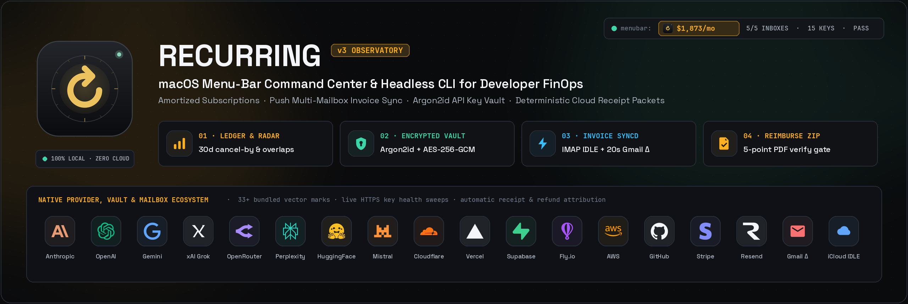
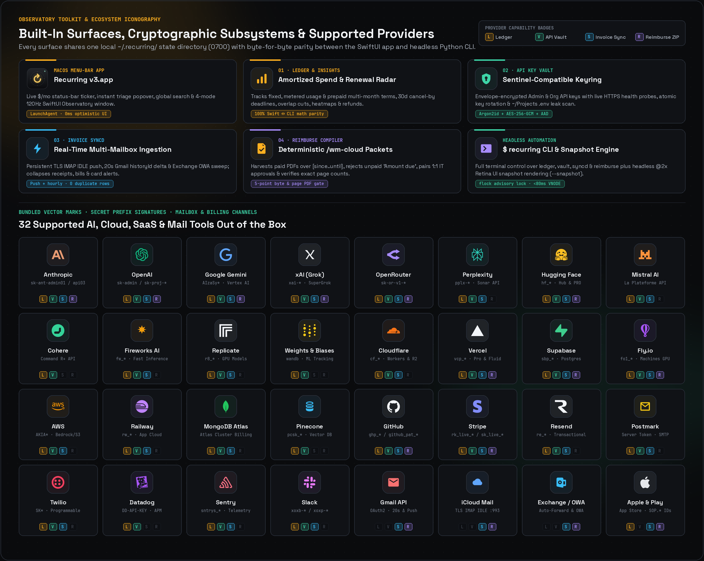
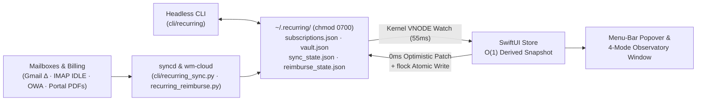

<div align="center">
  

  <br />

  <p>
    <a href="#quick-start"></a>
    <a href="#architecture--performance"></a>
    <a href="#cli-reference"></a>
    <a href="#security-model"></a>
    <a href="LICENSE"></a>
  </p>

  <p>
    <a href="#at-a-glance"><strong>Overview</strong></a> &nbsp;&middot;&nbsp;
    <a href="#tools--supported-provider-ecosystem"><strong>Tools &amp; Icons</strong></a> &nbsp;&middot;&nbsp;
    <a href="#interface-tour"><strong>Interface Tour</strong></a> &nbsp;&middot;&nbsp;
    <a href="#architecture--performance"><strong>Architecture</strong></a> &nbsp;&middot;&nbsp;
    <a href="#quick-start"><strong>Quick Start</strong></a> &nbsp;&middot;&nbsp;
    <a href="#cli-reference"><strong>CLI Reference</strong></a> &nbsp;&middot;&nbsp;
    <a href="#security-model"><strong>Security</strong></a>
  </p>
</div>

---

## At a Glance

**Recurring v3** is a local-first macOS menu-bar command center and companion headless CLI built on the **Observatory** dark visual system (`#0A0B0D` machined graphite, `#FFB020` signal amber, `#3DD4A7` mint, `#38BDF8` sky, `#FF5C6C` coral, bundled `Space Grotesk` + `JetBrains Mono`). It unifies **amortized subscription analytics**, **real-time multi-mailbox invoice sync**, **Sentinel-compatible encrypted API key governance**, and **deterministic cloud receipt reimbursement packets** inside `~/.recurring/` (`0700`)—with **zero cloud intermediaries** and **byte-for-byte math parity** between SwiftUI and the terminal.


### Menu-Bar Popover & Core Tool Surfaces


-  &nbsp;**`01 · Ledger & Insights`** — Models fixed subscriptions, metered usage bills, annual renewals, and upfront prepaid terms (`term_start → term_end` amortized across active days). Includes a 30-day cancel-by radar, overlap consolidation groups, settled-vs-scheduled monthly cash-flow bars, a 20-week daily charge heatmap, card/account attribution, post-cancel charge watch, and refund claim tracking.

-  &nbsp;**`02 · Vault · API Keys`** — Sentinel-compatible envelope-encrypted keyring (`Argon2id` + `AES-256-GCM` with AAD binding) supporting canonical **`Admin key`** & **`Org key`** tiers, live HTTPS endpoint health sweeps, atomic key rotation, `~/Projects` `.env` provenance + git-leak scanning, and 1-command Sentinel import.

-  &nbsp;**`03 · Invoice Sync (syncd)`** — Persistent LaunchAgent combining `TLS IMAP IDLE` push sockets, 20-second Gmail `historyId` delta polling, Exchange/OWA auto-forward rules, and an hourly safety sweep. Collapses duplicate merchant receipts, Apple/Play bills, and bank card alerts into clean ledger entries.

-  &nbsp;**`04 · Reimburse (wm-cloud)`** — Deterministic receipt packet compiler across any `[since .. until]` window. Rejects unpaid `"Amount due"` invoices, blocks double-submissions against prior sent batches, pairs 1:1 IT approvals, runs a 5-point byte/page PDF verify gate, and writes `<slug>.zip` + `approval-notice.txt` locally (never auto-sends).

-  &nbsp;**`$ recurring` Headless CLI & Snapshot Engine** — `flock`-synchronized terminal mutations reflected in the live SwiftUI app in `<80ms` via kernel `DispatchSource` VNODE watch, plus headless `@2x` Retina PNG snapshot generation (`--snapshot`).

<br clear="right" />

---

## Tools & Supported Provider Ecosystem

Recurring v3 bundles **33+ crisp vector provider marks**, secret-prefix detectors, live HTTPS health probes, multi-mailbox receipt parsers, and deterministic PDF compilers out of the box:



### Provider, Vault Key & Receipt Integration Matrix

| Provider / Tool | Secret Prefix / Protocol | Vault Health Probe & Tiers | Invoice `syncd` Parser | `04 · Reimburse` Packet |
| :--- | :--- | :--- | :---: | :---: |
|  &nbsp;**Anthropic (Claude)** | `sk-ant-admin01-*` · `sk-ant-api03-*` | Org key reconciliation + `/v1/models` probe | Paid receipts & Max plans | 1:1 PDF merge + IT approval |
|  &nbsp;**OpenAI** | `sk-admin-*` · `sk-proj-*` | `/v1/organization/projects` & `/v1/models` | ChatGPT Pro & API invoices | 1:1 PDF merge + IT approval |
|  &nbsp;**Google Gemini / Cloud** | `AIzaSy*` · Vertex / AI Ultra | Generative Language API health check | Cloud & Google AI Ultra | Attachment + HTML-to-PDF |
|  &nbsp;**xAI (Grok)** | `xai-*` | `/v1/api-key` & `/v1/models` check | API credits, SuperGrok & X | Alias-aware (`xai*`) pairing |
|  &nbsp;**OpenRouter** | `sk-or-v1-*` | `/api/v1/auth/key` credit & limit probe | Stripe & OpenRouter top-ups | Chronological multi-receipt PDF |
|  &nbsp;**Perplexity** | `pplx-*` | Sonar API key validation | Pro & API usage receipts | Supported via custom rule |
|  &nbsp;**Hugging Face** | `hf_*` | `/api/whoami-v2` token verification | PRO & Inference Endpoints | 1:1 PDF merge + IT approval |
|  &nbsp;**Mistral / Fireworks / Replicate** |  `fw_*` ·  `r8_*` ·  Cohere | Live `/v1/models` & account probes | Metered GPU & token bills | Supported |
|  &nbsp;**Cloudflare** | `cf_*` · Account / User tokens | `/client/v4/user/tokens/verify` | Workers, R2 & Registrar domains | Supported |
|  &nbsp;**Vercel** | `vcp_*` · Bearer access tokens | `/v2/user` & team token probe | Pro seats, Fluid & usage | 1:1 PDF merge + IT approval |
|  &nbsp;**Supabase** | `sbp_*` · `sb_secret_*` | `/v1/projects` Management API check | Paid receipts vs. `"Amount due"` | Auto-filters unpaid invoices |
|  &nbsp;**Fly.io / AWS / Railway** |  `AKIA*` · `fo1_*` ·  `rw_*` | GraphQL / token format & `.env` scan | Multi-page GPU & infra invoices | Full multi-page reconciliation |
|  &nbsp;**GitHub** | `ghp_*` · `github_pat_*` | `/user` scope & staleness (`≥90d`) check | Copilot, Actions & LFS bills | Blocks if IT approval pending |
|  &nbsp;**Stripe / Resend / Postmark** |  `re_*` · `rk_live_*` ·  Server | Restricted/API key liveness sweeps | Stripe receipts & credit refunds | Supported |
|  &nbsp;**Observability & Data** |  `sntrys_*` ·  `pcsk_*` ·   | `.env` provenance & git-leak detection | SaaS & cluster billing | Supported |
|  &nbsp;**Mail & App Store Channels** |  `IMAP :993` ·  `OWA` ·   | Keychain / encrypted OAuth token store | Apple expiry extend + `SOP.*` Play IDs | Canonical `SOP.*` monthly dedup |

---

## Interface Tour

### 1. Spend Analytics, Overlap Consolidation & Cash-Flow Attribution (`01 · Ledger`)
Cross-filter recurring spend by category, commitment structure (fixed recurring vs. metered usage vs. prepaid amortization), monthly settled-vs-scheduled cash flow, 20-week daily charge density, and payment account or card last-4.


---

### 2. Interactive Ledger Explorer & Vault Dependency Attribution (`01 · Ledger`)
Search, sort, and filter every active, unverified, closing, or cancelled plan—with inline **Vault key pills** showing exactly which runtime or admin API keys depend on each billed subscription.


---

### 3. Encrypted API Key Vault & `.env` Leak Scanner (`02 · API Vault`)
Govern `Admin` and `Org` keys across 30+ providers with `Argon2id` + `AES-256-GCM` envelope encryption, live endpoint health sweeps, `~/Projects` `.env` file provenance, git-tracked leak alerts, and 30-second auto-clearing clipboard copy.


---

### 4. Real-Time Multi-Mailbox Invoice Sync (`03 · Invoice Sync`)
Monitor per-mailbox push health (`LIVE PUSH`), inspect deduplicated receipts and negative refund credits, and triage newly discovered recurring merchants before promoting them into your ledger.


---

### 5. Deterministic Cloud & API Receipt Packet Compiler (`04 · Reimburse`)
Select any `[SINCE .. UNTIL]` date window (defaulting to the day after your last submitted batch), compile one chronological paid-receipts PDF per provider, verify 1:1 IT approval pairing and exact PDF page counts (`19 out == 19 src`), inspect blocked/deduped exclusions, reveal `<slug>.zip` in Finder, and copy the local approver notice draft.


---

## Architecture & Performance



| Subsystem | Design | Latency / Guarantee |
| :--- | :--- | :--- |
| **UI Mutations** | Optimistic `0ms` in-memory patch + background `DispatchQueue.utility` `flock` write | Instant click response, zero main-thread disk I/O |
| **CLI → UI Sync** | Kernel `DispatchSource.makeFileSystemObjectSource` VNODE watcher (`55ms` debounce) | `<80ms` live UI refresh on external CLI, `syncd`, or `wm-cloud` runs |
| **View Derivation** | Precomputed `Store.Derived`, `VaultSnapshot` & `ReimburseSnapshot` (`ExplorerState` isolated) | `O(1)` SwiftUI body reads; typing in search never recomputes charts |
| **CLI ↔ App Parity** | Shared normalization & schedule math pinned by `tests/fixtures/parity*.json` | 100% identical numbers across SwiftUI and `$ recurring` |
| **5-Point PDF Gate** | Byte-level `%PDF-` header check + `sum(source pages) == compiled PDF pages` | Zero silent page drops, unpaid `"Amount due"` leaks, or double-submits |
| **Headless Snapshots** | Parallel `ImageIO` PNG encoding + CoreGraphics `viewportCard` compositing | Crisp `@2x` Retina renders without opening any visible window |

---

## Quick Start

### Prerequisites
- **macOS 14.0+** (Sonoma, Sequoia, or Tahoe — Apple Silicon or Intel)
- **Xcode 15+** & [`xcodegen`](https://github.com/yonaskolb/XcodeGen) (`brew install xcodegen`)
- **Python 3.11+** (`brew install python`) with `cryptography`, `pypdf`, and `pymupdf` (`pip3 install cryptography pypdf pymupdf pytest`)

### Build, Test & Install

```bash
git clone https://github.com/antonio-mastropaolo/recurring.git
cd recurring

# 1. Run the full regression suite (45 Python CLI/vault/sync/reimburse tests + Swift ModelTests)
./scripts/test.sh

# 2. Build Release bundle, atomically install ~/Applications/Recurring v3.app,
#    link ~/.local/bin/recurring, and bootstrap LaunchAgents
./install.sh
```

`install.sh` performs an atomic bundle swap into `~/Applications/Recurring v3.app`, links `~/.local/bin/recurring`, purges stale LaunchServices ghosts, and registers two user LaunchAgents:
1. `com.amastro.recurring.v3.plist` — launches the menu-bar app automatically at login.
2. `com.amastro.recurring.v3.syncd.plist` — runs the persistent `IMAP IDLE` push + 20s Gmail delta + hourly invoice daemon (`~/.recurring/syncd.log`).

---

## Configuration

All personal state lives outside the repository inside `~/.recurring/` (`chmod 0700`, files `0600`) and is never tracked by git:

1. **Subscription Ledger (`~/.recurring/subscriptions.json`)** — Seed from [`examples/subscriptions.example.json`](examples/subscriptions.example.json) or add services via `recurring add`:
   ```bash
   mkdir -p -m 700 ~/.recurring
   cp examples/subscriptions.example.json ~/.recurring/subscriptions.json
   chmod 600 ~/.recurring/subscriptions.json
   ```
2. **Multi-Mailbox Invoice Sync (`~/.recurring/sync_config.json`)** — Configure Gmail OAuth, iCloud `IMAP IDLE`, Exchange forwarding, and custom vendor rules from [`examples/sync_config.example.json`](examples/sync_config.example.json):
   ```bash
   cp examples/sync_config.example.json ~/.recurring/sync_config.json
   chmod 600 ~/.recurring/sync_config.json
   ```
3. **Cloud Receipt Reimbursement Packets (`~/.recurring/reimburse_config.json`)** — Configure claimant profile, funding worktag, approver routing, and 1:1 IT approval ticket mappings from [`examples/reimburse_config.example.json`](examples/reimburse_config.example.json), and drop verified approval PDFs/PNGs into `~/.recurring/reimbursements/approvals/`:
   ```bash
   mkdir -p -m 700 ~/.recurring/reimbursements/approvals
   cp examples/reimburse_config.example.json ~/.recurring/reimburse_config.json
   chmod 600 ~/.recurring/reimburse_config.json
   ```

Override paths on demand via `RECURRING_FILE`, `RECURRING_SYNC_CONFIG`, or `RECURRING_REIMBURSE_CONFIG` (or `--ledger /path/to/subscriptions.json` on the app binary).

---

## CLI Reference

```bash
# ── 01 · Ledger & Spend Analytics ─────────────────────────────────────────────
recurring                                # Active subscriptions grouped by category + run-rate totals
recurring list --all                     # Include unverified and cancelled items
recurring report [--back 4 --ahead 11] [--json]
                                         # Cadence mix, category/account/card attribution, monthly cash out
recurring upcoming [--days 7]            # Upcoming charges, prepaid expiries, and wind-downs
recurring renewals [--days 30] [--min 0] # Upcoming renewals with exact last day to cancel
recurring needs                          # Closing, unverified, and flagged items needing review
recurring watch                          # Post-cancellation charge watch & pending refund claims
recurring savings [--days 30]            # Monthly run-rate saved by cancellations
recurring cut                            # Overlapping plan groups with consolidation savings

# ── Ledger Mutations (flock-synchronized with the running macOS app) ──────────
recurring add "Linear" --amount 28 --day 19 --category "Professional" --account billing@studio.io --card 8810
recurring charge linear 28.00 --date 2026-11-19
recurring closing linear --note "Migrating workspace"
recurring cancel linear --ends 2026-12-19
recurring refund linear 28.00 --status requested --note "Pro-rata unused seat"
recurring set linear plan="Business" group="Issue Trackers"

# ── 02 · Encrypted API Key Vault (Argon2id + AES-256-GCM) ─────────────────────
recurring vault init                     # Initialize Argon2id + AES-256-GCM master key (stdin passphrase)
recurring vault unlock                   # Unlock vault for a 12h macOS Keychain-backed session
recurring vault lock                     # Wipe active session key immediately
recurring vault status [--json]          # Lock state, Admin/Org tier counts, health & git-leak summary
recurring vault list [--all] [--json]    # List key metadata (never prints raw secrets or ciphertexts)
recurring vault add --provider anthropic --label prod-agent --tier org --secret-stdin
recurring vault secret <key-id>          # Decrypt & output raw secret (requires unlocked session)
recurring vault rotate <key-id> --secret-stdin
                                         # Revoke old key (wipe ciphertext) & store replacement atomically
recurring vault sweep                    # Probe live HTTPS provider endpoints & reconcile Anthropic Org keys
recurring vault scan [~/Projects]        # Scan .env files for key provenance & git-tracked leaks
recurring vault import-sentinel          # Import encrypted keys & master.key from ~/.sentinel

# ── 03 · Multi-Mailbox Invoice Sync (syncd) ───────────────────────────────────
recurring sync                           # Run an immediate sweep across all configured mailboxes
recurring sync --status                  # Inspect syncd PID, per-mailbox push latency, and recent matches
recurring sync --trigger                 # Wake the running syncd daemon immediately (SIGUSR1)
recurring sync --daemon                  # Run persistent IMAP IDLE + Gmail historyId delta + hourly daemon

# ── 04 · Deterministic Cloud & API Receipt Packets (wm-cloud / reimburse) ─────
recurring wm-cloud --since 2026-10-19    # Harvest paid PDFs, pair 1:1 IT approvals, verify & build .zip
recurring reimburse build --since 2026-10-19 --until 2026-11-13 [--cover] [--json]
recurring reimburse verify               # Run 5-point byte & page anti-hallucination gate on latest batch
recurring reimburse approvals            # Inspect verified IT approval artifacts & pending tickets
recurring reimburse status [--json]      # Print default cutoff, approval count & latest packet summary
```

### Headless Retina Snapshot Rendering

Render `@2x` PNG snapshots of every UI surface (`popover.png`, `dashboard.png`, `vault.png`, `sync.png`, `reimburse.png`, plus cropped card views) completely headlessly without opening a window:

```bash
"$HOME/Applications/Recurring v3.app/Contents/MacOS/Recurring v3" \
  --snapshot ~/.recurring/snapshots \
  --ledger ~/.recurring/subscriptions.json
```

---

## Security Model

-  **Strict Local Permissions & Symlink Defense** — Every state file (`subscriptions.json`, `vault.json`, `master.key`, `sync_state.json`, `reimburse_state.json`, `seen_messages.json`, and rendered snapshots) is written atomically via temp-file + `fsync` + `rename` with mode `0600` inside `0700` directories using `O_NOFOLLOW` symlink guards and shared `fcntl.flock` advisory locks.
-  **Authenticated Envelope Encryption** — Vault secrets are encrypted under a 256-bit master key wrapped with `Argon2id` (`ops=3`, `mem=64 MiB`, `parallelism=4`) and `AES-256-GCM` with per-record 96-bit random nonces and AAD binding `"{id}|{provider}|{tier}"` so ciphertexts cannot be transplanted across records or tiers.
-  **Zero `argv` Secret Exposure** — Passphrases, API keys, and macOS Keychain transfers (`security -i` batch stdin) travel exclusively over stdin pipes—never command-line arguments visible in `ps`.
-  **SSRF, HTML Sanitization & Never-Auto-Send Gate** — Billing URLs, provider health probes, and HTML-to-PDF receipt renderers strip active tags (`<script>`, `<iframe>`, `<object>`, `<embed>`, event handlers, remote stylesheets) and block loopback/RFC1918/link-local/non-HTTPS targets. Reimbursement packets draft `approval-notice.txt` locally and never send outbound mail automatically.
-  **Ephemeral Clipboard Hygiene** — Copying a secret from the Vault tags `NSPasteboard` as concealed/transient (`org.nspasteboard.ConcealedType`) and schedules an automatic 30-second clipboard clear if the pasteboard change count has not moved.

---

## Repository Layout

```text
Recurring/
├── RecurringApp/
│   ├── Sources/
│   │   ├── RecurringApp.swift     # Entry point, menu-bar controller & headless --snapshot engine
│   │   ├── Model.swift            # Pure schema, billing schedule math, insights & parity logic
│   │   ├── Store.swift            # O(1) reactive store, kernel VNODE watcher, Vault/Sync/Reimburse bridge
│   │   ├── Theme.swift            # Observatory color tokens, typography & reusable surfaces
│   │   ├── MenuBarView.swift      # Compact menu-bar popover
│   │   ├── DashboardView.swift    # 4-mode Observatory window + Service Inspector drawer
│   │   ├── InsightViews.swift     # Renewal radar, 20-week heatmap, attribution & Ledger Explorer
│   │   ├── VaultView.swift        # 02 · Encrypted API Key Vault UI
│   │   ├── SyncCenterView.swift   # 03 · Real-Time Multi-Mailbox Invoice Sync UI
│   │   └── ReimburseView.swift    # 04 · Deterministic Cloud Receipt Packet Compiler UI
│   ├── Assets.xcassets/           # Procedural AppIcon + 33 bundled vector provider marks
│   └── Fonts/                     # Bundled Space Grotesk + JetBrains Mono
├── cli/
│   ├── recurring                  # Main CLI router, ledger queries, reports & atomic mutations
│   ├── recurring_sync.py          # Multi-mailbox IMAP IDLE + Gmail delta + OWA sync daemon
│   ├── recurring_vault.py         # Argon2id + AES-256-GCM vault, health sweeps & .env leak scanner
│   └── recurring_reimburse.py     # Deterministic receipt harvest, 5-point PDF gate & ZIP bundler
├── docs/
│   ├── assets/                    # Hero banner, 32-provider ecosystem board & OpenGraph card
│   ├── icons/                     # 45 dark-tile SVG tool, provider & transport badges
│   └── screenshots/               # @2x Retina UI renders generated from synthetic showcase state
├── examples/
│   ├── subscriptions.example.json # Starter ledger schema example
│   ├── sync_config.example.json   # Starter multi-mailbox sync configuration
│   └── reimburse_config.example.json # Starter cloud receipt packet configuration
├── scripts/
│   ├── test.sh                    # End-to-end Python pytest + Swiftc ModelTests runner
│   └── make-icon.swift            # Procedural Observatory AppIcon generator
├── tests/
│   ├── test_cli.py                # 45 CLI, sync, vault, reimburse, lock & security tests
│   ├── ModelTests.swift           # Swift model, parity & URL safety test suite
│   └── fixtures/                  # Cross-language CLI ↔ Swift parity fixtures
├── install.sh                     # Atomic Release installer + LaunchAgent bootstrapper
├── project.yml                    # XcodeGen specification
└── LICENSE                        # MIT License
```

---

## License

Released under the [MIT License](LICENSE).
